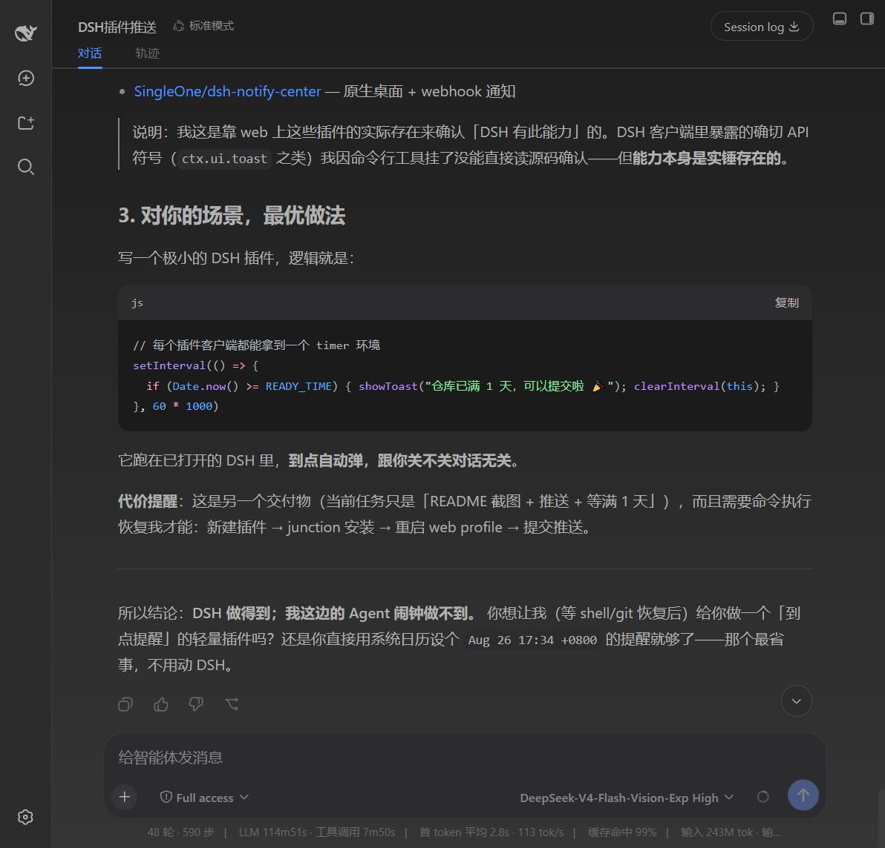
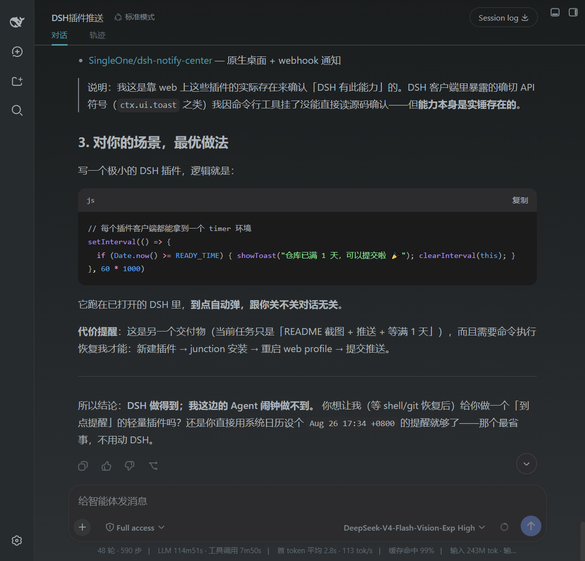
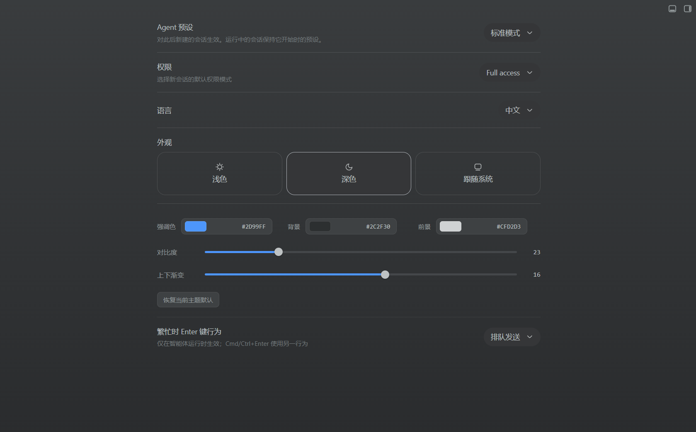
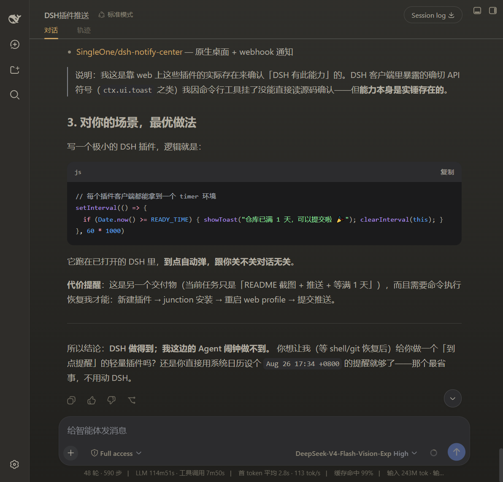
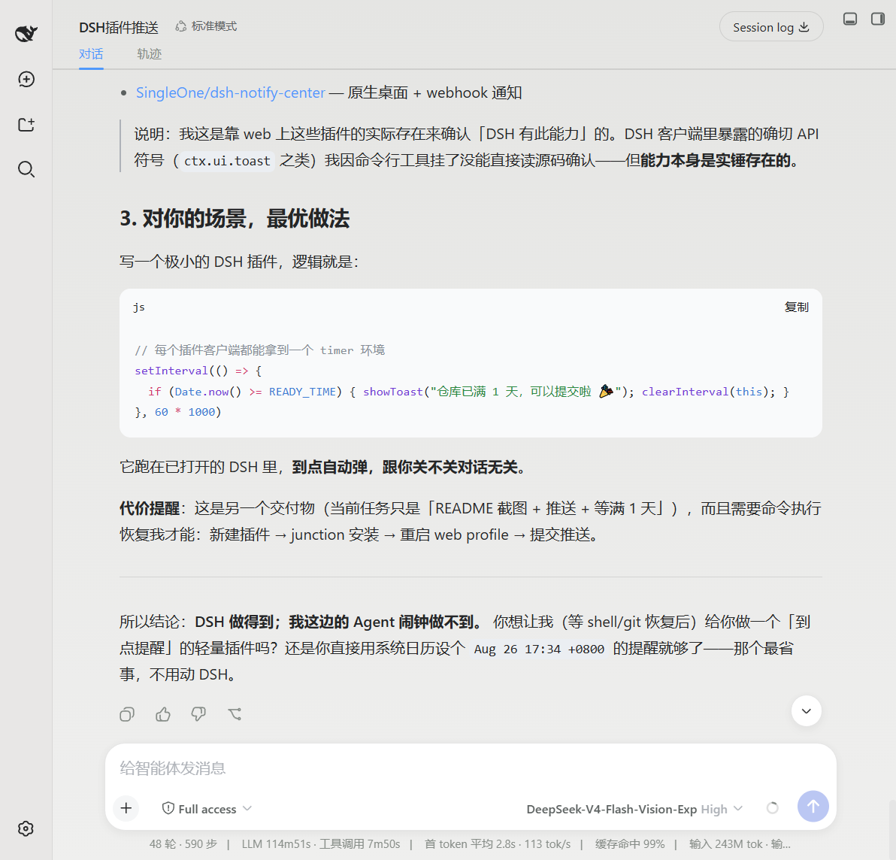
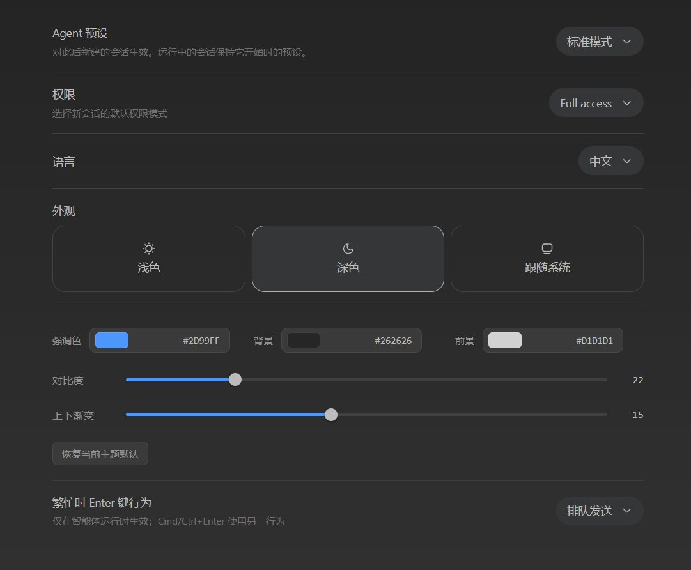

# dsh-theme-tuner

> [English](README_en.md)

在 DeepSeek Harness (DSH) 的「通用设置 → 外观」下方直接调整界面主题——**强调色 / 背景 / 前景 / 对比度 / 渐变度**，实时生效。

> 复用「外观」自带的 **浅色 / 深色 / 跟随系统** 切换，无需重复的切换按钮。

## 效果

| <br>深色 · 主题效果 | <br>深色 · 主题效果 | <br>深色 · 主题效果 |
| --- | --- | --- |
| <br>深色 · 主题效果 | <br>浅色 · 主题效果 | <br>主题调节面板 |

## 功能

- 挂在「通用设置 → 外观」正下方，调整 **强调色 / 背景 / 前景 / 对比度 / 渐变度**。
- 复用「外观」的 浅色 / 深色 / 跟随系统 切换，针对**当前激活主题**调整。
- 浅色、深色两套配色**分别保存**；对比度按当前主题微调前景文字的清晰度。
- 改动**实时生效**（`theme.overrideTokens` 写入 `--dsw-alias-*` 设计变量），可一键**恢复当前主题默认**。

## 安装

```sh
dsh plugin --profile web add github:shawnlone/dsh-theme-tuner
```

> 本仓库按「仓库根即插件包」组织：`package.json` 声明了 `dsh.bundle.patch`（安装入口）与 `dsh.client`（浏览器端 UI），根目录放置 `cordis.patch.yml`。
> 新增插件需 **重启一次对应的 web profile** 才会生效。另提供 `scripts/install.ps1` / `scripts/install.sh` 一键脚本（内含 pnpm 供应链策略无法通过时的本地 junction 安装回退）。

## 原理

插件通过 `theme.overrideTokens` 把自定义值写入 DSH 的设计 token：

- **强调色**：`--dsw-alias-brand-primary` / `--dsw-alias-button-primary-fill` / `--dsw-alias-state-business-primary`
- **背景**：`--dsw-alias-bg-base` / `--dsw-alias-bg-layer-1/2/3` / `--dsw-specific-sidebar-fill`
- **前景**：`--dsw-alias-label-primary/secondary/tertiary`（由所选前景色 + 对比度自动推导）

设置经 `theme-tuner` 命名空间持久化；设置行注册到 `settings.general.item`（order 10.5），排在「外观」（order 10）正下方（DSH 0.1.2-rc.1 起新增的「字号大小」在 order 11、「对话显示」在 order 12，故用 10.5 保持紧贴外观）。

### DSH 版本支持

同一份产物同时适配两代设置层：

| DSH | 设置服务 | 持久化结构 |
| --- | --- | --- |
| `0.2.x` | `ctx.configForms.get("theme-tuner")` | 导出的 `Config`（字段标记 `.volatile()`） |
| `<= 0.1.x` | `ctx.settingsScope.bind({ namespace: "theme-tuner" })` | `settings.register("theme-tuner", schema)` |

两种情况下命名空间**就是** `cordis.patch.yml` 里声明的 profile 条目 id `theme-tuner`，存储结构为 `{ light: {...}, dark: {...} }`。

DSH 0.2.0 起还会在**安装时**校验插件兼容性：如果某个 bundle 的 `@deepseek-ai/dsh*` peer 范围不覆盖当前运行时，安装会被直接拒绝（`Plugin ... is incompatible with dsh ...`）。因此这里的 peer 范围放宽到 `>=0.1.1-rc.2 <0.3.0`。

> 升级后如果设置行没出现，先检查 profile 而不是插件：`dsh-theme-tuner` 必须出现在 `$DSH_HOME/profiles/web/package.json` 的 `dsh.profile.bundles` 中，并且不能出现在 `$DSH_HOME/profiles/web/disabled-plugins.json` 里。`scripts/install.ps1` / `scripts/install.sh` 会自动补回该 bundle 条目。

## 目录结构

```
dsh-theme-tuner/
  package.json          # 双面插件清单：dsh.client + dsh.bundle.patch
  cordis.patch.yml      # bundle 挂载行 (insert)；其 id 即设置命名空间
  lib/index.js          # 主机半区：导出 Config schema 并挂接设置层
  lib/client.js         # 浏览器半区：设置行 UI + 实时 token 应用
  scripts/              # install.ps1 / install.sh
  preview.html          # 独立效果演示
  assets/               # 文档 / 插件市场截图
```

## 许可证

[MIT](LICENSE)
